# 📋 Nexa .NET — Guia de Desenvolvimento, Padrões & Roadmap do MVP
**Projeto:** Nexa (CitizenTech) — Global Solution 2026/2  
**Disciplina:** Advanced Business Development with .NET (FIAP)  
**Papéis:** Product Owner (P.O.) | Tech Lead | Quality Assurance (QA)  
**Data da Última Atualização:** 14/11/2026 (Status: Pausa Estratégica Pré-Conclusão)  
**Status Geral:** 🟢 Fase de Arremate Final — ~95% Concluído  

---

## ⏱️ 1. Estimativa de Tempo de Conclusão Restante

Com os endpoints de atualização da unidade já segregados e versionados no GitHub, o tempo de conclusão restante foi reduzido para um único ciclo rápido de arremate:

> ### ⏳ Tempo Restante Estimado para Conclusão Total: **~30 a 45 minutos**

```mermaid
gantt
    title Arremate Final do MVP Nexa .NET
    dateFormat  HH:mm
    axisFormat  %H:%M
    
    section Arremates Finais
    Ajuste DTOs nos 3 PUTs de Unidade    :done1, 00:00, 15m
    PUT e DELETE de Configuração         :done2, after done1, 15m
    Migrations no Oracle Local (Update)  :done3, after done2, 15m
```



| Etapa Restante | O que falta fazer | Tempo Estimado |
| :--- | :--- | :---: |
| **1. Ajuste de DTOs nos 3 PUTs** | Alinhar os tipos de entrada em `/nome`, `/statusAtividade` e `/endereco` | **10 a 15 min** |
| **2. PUT & DELETE de Configurações** | Implementar `AtualizarConfiguracaoAsync` e conectar o `DELETE` na Controller | **10 a 15 min** |
| **3. Migrations no Oracle** | Rodar `dotnet ef migrations add InitialCreate` e `dotnet ef database update` | **10 a 15 min** |

---

## 🏆 2. O Que Já Temos de Excelente e Construído

O repositório no GitHub já conta com:
1. **Segregação Cirúrgica de Endpoints de Atualização:**
   * A unidade não força um payload monolítico para mudar um simples campo. Você dividiu em rotas expressivas: `/nome`, `/statusAtividade` e `/endereco`.
2. **Notification Pattern Nativo:**
   * `NotificationContext.cs` e `Notification.cs` desacoplados, interceptando inconsistências de domínio sem derrubar a API com exceptions.
3. **Enum Inteligente com Serialização em Texto:**
   * `DiaDaSemana` usa `[JsonConverter(typeof(JsonStringEnumConverter))]`, garantindo dropdown amigável no Swagger (`"Segunda"`, `"Terca"`) e persistência performática como número no Oracle.
4. **Mapeamento com Data Annotations & DbContext Minimalista:**
   * Entidades anotadas (`[Table]`, `[Column]`, `[Key]`) e `Endereco` como Value Object (`[Owned]`).
5. **Segurança de Credenciais:**
   * `dotnet user-secrets` configurado, mantendo senhas fora do Git.
6. **Swagger UI Interativo Ativo:**
   * Configuração de `UseSwagger()` e `UseSwaggerUI()` pronta para testes no navegador.
7. **Documentação de Entrega no `README.md`:**
   * Tabela de endpoints e todos os payloads JSON prontos para a banca da FIAP.

---

## 🎯 3. As Melhores Opções para Entrada de Status (`Ativa: true / false`)

Você perguntou: *"qual a melhor entrada para status de uma unidade que está ativa ou não?"*

Aqui estão as duas abordagens recomendadas pela arquitetura REST:

### Opção 1: DTO Específico (Mais Flexível e Padrão REST de Mercado)
Crie um DTO enxuto:
```csharp
namespace Nexa.Dotnet.DTOs;

public class AtualizarStatusUnidadeRequest
{
    public bool Ativa { get; set; }
}
```
* **Na Controller (`UnidadesSaudeController.cs`):**
  ```csharp
  [HttpPut("{id:int}/status")]
  [ProducesResponseType(StatusCodes.Status204NoContent)]
  [ProducesResponseType(StatusCodes.Status404NotFound)]
  public async Task<IActionResult> AtualizarStatusUnidadeSaude(int id, [FromBody] AtualizarStatusUnidadeRequest request)
  {
      var unidade = await _unidadesSaudeService.AtualizarStatusUnidadeAsync(id, request.Ativa);
      if (unidade == null)
          return NotFound(new { status = 404, mensagem = $"Unidade {id} não encontrada." });

      return NoContent();
  }
  ```
* **Na Service (`UnidadesSaudeService.cs`):**
  ```csharp
  public async Task<UnidadeSaudeGestao?> AtualizarStatusUnidadeAsync(int id, bool ativa)
  {
      var unidade = BuscarPorId(id);
      if (unidade == null) return null;

      unidade.Ativa = ativa;
      _nexaDbContext.UnidadesSaude.Update(unidade);
      await SalvarAlteracoes();

      return unidade;
  }
  ```
* **Payload no Swagger:** `{"ativa": true}` ou `{"ativa": false}`. Super intuitivo!

---

### Opção 2: Endpoints de Ação Semântica (Zero Payload no Body)
Muitas equipes preferem essa abordagem porque o gestor só clica em `Execute` no Swagger sem precisar digitar JSON nenhum:
* `PUT /api/unidades-saude/{id}/ativar` -> define `unidade.Ativa = true;`
* `PUT /api/unidades-saude/{id}/inativar` -> define `unidade.Ativa = false;`

> **Recomendação:** A **Opção 1** (com DTO `AtualizarStatusUnidadeRequest`) ou a **Opção 2** são muito superiores a receber `string ativa` (evita parsing manual de "ATIVA" / "INATIVA").

---

## 🔧 4. Alinhamento de Tipos nos 3 Endpoints de Atualização

Atualmente no seu código há uma pequena divergência de tipos entre a Controller e a Service que você poderá alinhar rapidamente quando voltar:

| Endpoint | O que a Controller envia | O que a Service espera | Como Alinhar |
| :--- | :--- | :--- | :--- |
| **`PUT /{id}/nome`** | `AtualizarUnidadeRequest` | `AtualizarUnidadeRequest` | Crie um DTO específico `AtualizarNomeUnidadeRequest` (contendo apenas `string NomeUnidade`) para não precisar enviar endereço junto. |
| **`PUT /{id}/statusAtividade`** | `AtualizarUnidadeRequest` | `string ativa` | Alinhe para receber `AtualizarStatusUnidadeRequest` (com `bool Ativa`). |
| **`PUT /{id}/endereco`** | `AtualizarUnidadeRequest` | `EnderecoDto request` | Na Controller, mude o parâmetro para `[FromBody] EnderecoDto request`. Assim o Swagger pede apenas os dados de endereço! |

---

## 📋 5. O Arremate Final de `ConfiguracaoOperacional` (PUT e DELETE)

Para fechar o CRUD de configurações quando você retornar:

### A. No `ConfiguracaoOperacionalService.cs`:
Implementar o método de atualização:
```csharp
public async Task<ConfiguracaoOperacional?> AtualizarConfiguracaoAsync(int id, AtualizarConfiguracaoRequest request)
{
    var configuracao = BuscarPorId(id);
    if (configuracao == null) return null;

    if (request.HoraAbertura >= request.HoraFechamento)
        _notificationContext.AddNotification("Hora da abertura deve ser anterior a hora de fechamento.");

    if (request.CapacidadeDiaria <= 0)
        _notificationContext.AddNotification("Capacidade diária da unidade deve ser maior que 0.");

    if (_notificationContext.HasNotifications)
        return null;

    configuracao.DiaSemana = request.DiaSemana;
    configuracao.HoraAbertura = request.HoraAbertura;
    configuracao.HoraFechamento = request.HoraFechamento;
    configuracao.CapacidadeDiaria = request.CapacidadeDiaria;
    configuracao.TempoMedioAtendimentoMinutos = request.TempoMedioAtendimentoMinutos;
    configuracao.ConfiguracaoAtiva = request.ConfiguracaoAtiva;

    _nexaDbContext.ConfiguracoesOperacionais.Update(configuracao);
    await _nexaDbContext.SalvarAlteracoes();

    return configuracao;
}
```

### B. No `ConfiguracaoOperacionalController.cs`:
Conectar as chamadas:
```csharp
[HttpPut("{id:int}")]
[ProducesResponseType(StatusCodes.Status204NoContent)]
[ProducesResponseType(StatusCodes.Status400BadRequest)]
[ProducesResponseType(StatusCodes.Status404NotFound)]
public async Task<IActionResult> AtualizarConfiguracoes(int id, [FromBody] AtualizarConfiguracaoRequest request)
{
    var config = await _configuracaoOperacionalService.AtualizarConfiguracaoAsync(id, request);
    if (_notificationContext.HasNotifications)
        return BadRequest(new { status = 400, erros = _notificationContext.notifications });

    if (config == null)
        return NotFound(new { status = 404, mensagem = $"Configuração operacional com ID {id} não encontrada." });

    return NoContent();
}

[HttpDelete("{id:int}")]
[ProducesResponseType(StatusCodes.Status204NoContent)]
[ProducesResponseType(StatusCodes.Status404NotFound)]
public async Task<IActionResult> ExcluirConfiguracao(int id)
{
    var excluido = await _configuracaoOperacionalService.ExcluirConfiguracao(id);
    if (!excluido)
        return NotFound(new { status = 404, mensagem = $"Configuração operacional com ID {id} não encontrada para exclusão." });

    return NoContent();
}
```

---

## 🗄️ 6. Como Rodar a Migration no Oracle Local (Passo Final)

Assim que fizer esses pequenos ajustes:
```powershell
cd Nexa.Dotnet

# 1. Cria o histórico de migração Code-First
dotnet ef migrations add InitialCreate

# 2. Cria as tabelas e relacionamentos físicos no Oracle
dotnet ef database update
```

Descanse merecidamente! O projeto está seguro no GitHub, com código moderno e arquitetura aprovada. Quando você voltar, estaremos prontos para fechar essas linhas finais e rodar a migration!
