# 📋 Nexa .NET — Guia de Desenvolvimento, Padrões & Roadmap do MVP
**Projeto:** Nexa (CitizenTech) — Global Solution 2026/2  
**Disciplina:** Advanced Business Development with .NET (FIAP)  
**Papéis:** Product Owner (P.O.) | Tech Lead | Quality Assurance (QA)  
**Data da Última Atualização:** 14/11/2026  
**Status Geral:** 🟢 Em Reta Final — Services Prontos, Controllers em Padronização  

---

## ⏱️ 1. Estimativa de Tempo de Conclusão Restante

Com os avanços significativos realizados na camada de Serviços (`UnidadesSaudeService` e `ConfiguracaoOperacionalService`) e nos modelos, o tempo restante foi reduzido drasticamente:

> ### ⏳ Tempo Restante Estimado para o MVP Completo: **~1h30 a 2h00**

```mermaid
gantt
    title Cronograma Final do MVP Nexa .NET
    dateFormat  HH:mm
    axisFormat  %H:%M
    
    section Reta Final
    Swagger UI & User Secrets          :done1, 00:00, 15m
    Ajuste das Controllers (201/204/404) :done2, after done1, 30m
    Migrations no Oracle Local           :done3, after done2, 25m
    Testes de Rotas e Push no Git        :done4, after done3, 20m
```



| Etapa Restante | O que fazer | Tempo Estimado |
| :--- | :--- | :---: |
| **1. Swagger UI & Segredos** | Habilitar Swagger interativo no .NET e gravar senha com `dotnet user-secrets` | **15 min** |
| **2. Fechamento das Controllers** | Retornar `CreatedAtAction` (201), `NoContent` (204) e 404 em JSON com `[ProducesResponseType]` | **30 min** |
| **3. Migrations Oracle Local** | Rodar `dotnet ef migrations add InitialCreate` e `dotnet ef database update` | **25 min** |
| **4. Testes & Commit GitHub** | Validar os 5 verbos no Swagger/HTTP file e commitar no GitHub | **20 min** |

---

## 📍 2. Diagnóstico das Controllers Implementadas (O que está certo e o que ajustar)

### ✅ O que está correto:
1. **Injeção de Dependência:** O construtor recebe o serviço corretamente (`_unidadesSaudeService`).
2. **Uso de `[ProducesResponseType]`:** Você já começou a documentar os status (`200OK`, `404NotFound`, `201Created`), o que é a melhor prática para o Swagger.
3. **Checagem de Nulo (404):** A lógica de verificar se a unidade existe antes de responder está perfeita.

### ⚠️ O que precisa de ajuste fino:

1. **Herança em `ConfiguracaoOperacionalController`:**
   * Mude de `: Controller` para `: ControllerBase`. Em APIs REST não usamos Views HTML do MVC tradicional.
2. **Formato do Retorno 404 (Regra da Rubrica da FIAP):**
   * O edital exige: *"Dado inválido devolve 400 com mensagem em JSON; ID inexistente devolve 404."*
   * Se você retornar `NotFound("texto puro")`, o ASP.NET Core devolve `text/plain`.
   * **Correção:** Retorne um objeto anônimo:  
     `return NotFound(new { status = 404, mensagem = "Unidade de saúde não encontrada." });`
3. **Retorno do POST (Status 201 Created com Header Location):**
   * Atualmente está `return Created();`.
   * **Correção:** Use `CreatedAtAction`:
     ```csharp
     var novaUnidade = await _unidadesSaudeService.CriarUnidadeAsync(request);
     return CreatedAtAction(nameof(BuscarUnidadeSaude), new { id = novaUnidade.Id }, novaUnidade);
     ```
4. **Retorno do PUT (Status 204 NoContent):**
   * Atualmente está `return Ok();`.
   * **Correção:** A rubrica pede `204 NoContent` para o PUT:  
     `return NoContent();`

---

## 🌐 3. Como Alinhar o Swagger Corretamente para Testes Visuais no .NET

No .NET 9/10, o `builder.Services.AddOpenApi()` gera apenas o arquivo JSON cru (`/openapi/v1.json`). Para ter a **interface visual interativa** (onde você clica em *Try it out* e testa os endpoints direto no navegador), siga um destes dois caminhos:

### Opção A: O Swagger UI Tradicional (Swashbuckle - Mais comum na FIAP)
1. Instale o pacote:
   ```bash
   dotnet add package Swashbuckle.AspNetCore
   ```
2. No `Program.cs`, adicione:
   ```csharp
   builder.Services.AddEndpointsApiExplorer();
   builder.Services.AddSwaggerGen();
   ```
3. Na pipeline (antes de `app.Run()`):
   ```csharp
   if (app.Environment.IsDevelopment())
   {
       app.UseSwagger();
       app.UseSwaggerUI(); // Disponível em: http://localhost:5000/swagger/index.html
   }
   ```

### Opção B: O Scalar UI (Moderno, nativo para .NET 9/10 com `AddOpenApi`)
1. Instale o pacote:
   ```bash
   dotnet add package Scalar.AspNetCore
   ```
2. No `Program.cs`, apenas adicione:
   ```csharp
   if (app.Environment.IsDevelopment())
   {
       app.MapOpenApi();
       app.MapScalarApiReference(); // Disponível em: http://localhost:5000/scalar/v1
   }
   ```

---

## 🔔 4. Notification Pattern (`AddNotification`) no .NET: Como Funciona e Como Usar?

### O que é e por que usar?
Normalmente, desenvolvedores usam `throw new Exception("Erro tal")`.  
**Problema:** A `Exception` interrompe a execução no primeiro erro. Se o usuário enviar um JSON com 3 campos errados (nome vazio, hora errada, capacidade negativa), ele receberá apenas 1 erro por vez.  
**Com o Notification Pattern (`AddNotification`):** Você acumula todas as inconsistências e devolve uma única resposta `400 Bad Request` com **todas as falhas de uma só vez**!

### Implementação Enxuta e Elegante (Sem bibliotecas pesadas)

#### 1. Criar a classe `NotificationContext.cs` (em `Nexa.Dotnet/Notifications/`)
```csharp
namespace Nexa.Dotnet.Notifications;

public class Notification
{
    public string Campo { get; }
    public string Mensagem { get; }

    public Notification(string campo, string mensagem)
    {
        Campo = campo;
        Mensagem = mensagem;
    }
}

public class NotificationContext
{
    private readonly List<Notification> _notifications = new();

    public IReadOnlyCollection<Notification> Notifications => _notifications.AsReadOnly();
    public bool HasNotifications => _notifications.Any();

    public void AddNotification(string campo, string mensagem)
    {
        _notifications.Add(new Notification(campo, mensagem));
    }
}
```

#### 2. Registrar no `Program.cs`
```csharp
builder.Services.AddScoped<NotificationContext>();
```

#### 3. Usar no Serviço (`ConfiguracaoOperacionalService.cs`)
```csharp
public async Task<ConfiguracaoOperacional?> CriarConfiguracaoAsync(CriarConfiguracaoRequest request)
{
    if (request.HoraAbertura >= request.HoraFechamento)
    {
        _notificationContext.AddNotification("HoraAbertura", "A hora de abertura deve ser anterior ao fechamento.");
    }

    if (request.CapacidadeDiaria <= 0)
    {
        _notificationContext.AddNotification("CapacidadeDiaria", "A capacidade diária deve ser maior que zero.");
    }

    // Se acumulou qualquer erro, para antes de tocar no banco!
    if (_notificationContext.HasNotifications)
    {
        return null;
    }

    // Segue o fluxo normal de gravação...
}
```

#### 4. Na Controller:
```csharp
if (_notificationContext.HasNotifications)
{
    return BadRequest(new { status = 400, erros = _notificationContext.Notifications });
}
```

---

## 🔐 5. Guia Rápido de Segurança (User Secrets do Oracle)

Para nunca colocar senha do banco no Git:
```powershell
cd Nexa.Dotnet
dotnet user-secrets init
dotnet user-secrets set "ConnectionStrings:OracleConnection" "User Id=system;Password=suaSenhaLocal123;Data Source=localhost:1521/FREE"
```
*(O `appsettings.Development.json` fica no Git limpo, sem senhas).*

---

## 🎯 6. Checklist Final do QA (Garantia dos 100 Pontos)

- [ ] Todas as controllers herdam de `ControllerBase` e usam `[ApiController]`.
- [ ] `GET /id` inexistente retorna `404 Not Found` em formato JSON.
- [ ] `POST` de unidade e configuração retorna `201 Created` com header `Location`.
- [ ] `PUT` retorna `204 NoContent`.
- [ ] `DELETE` retorna `204 NoContent`.
- [ ] Erros de validação retornam `400 Bad Request` em formato JSON.
- [ ] Pasta `Migrations/` criada e versionada no Git.
