# 📋 Nexa .NET — Guia de Desenvolvimento, Padrões & Roadmap do MVP
**Projeto:** Nexa (CitizenTech) — Global Solution 2026/2  
**Disciplina:** Advanced Business Development with .NET (FIAP)  
**Papéis:** Product Owner (P.O.) | Tech Lead | Quality Assurance (QA)  
**Data da Última Atualização:** 15/11/2026  
**Status Geral:** 🟢 Reta Finalíssima — ~98% Concluído  

---

## ⏱️ 1. Estimativa de Tempo Restante para Conclusão Total

Com os commits mais recentes (`b2dbf19` e `a3cc1c2`), você fechou a implementação dos endpoints de atualização, exclusão e regras operacionais. Restam apenas pequenos ajustes pontuais de chamada assíncrona/busca e a execução das migrations no banco:

> ### ⏳ Tempo Restante Estimado: **~25 a 35 minutos (< 0.5 hora de trabalho)**

```mermaid
gantt
    title Reta Final do MVP Nexa .NET
    dateFormat  HH:mm
    axisFormat  %H:%M
    
    section Ajustes Finais & QA
    Ajustes pontuais (await e BuscarPorId) :done1, 00:00, 10m
    Execução da Migration no Oracle       :done2, after done1, 10m
    Bateria de Testes no Swagger UI      :done3, after done2, 10m
```



| Etapa Restante | O que fazer | Tempo Estimado |
| :--- | :--- | :---: |
| **1. Ajustes Pontuais de QA** | Inserir `await` em 2 chamadas, corrigir `BuscarPorId` na service e tipo de enum no DTO | **10 min** |
| **2. Migrations no Oracle** | Executar `dotnet ef migrations add InitialCreate` e `dotnet ef database update` | **10 min** |
| **3. Validação no Swagger** | Executar o fluxo completo (POST -> GET -> PUT -> DELETE + 400/404) | **10 min** |

---

## 🏆 2. O Que Já Está Pronto e Construído (98%)

1. **CRUD Completo de Unidades de Saúde:**
   * `GET /api/unidades-saude` (200 OK)
   * `GET /api/unidades-saude/{id}` (200 OK / 404 NotFound com JSON)
   * `POST /api/unidades-saude` (201 Created com header Location)
   * `DELETE /api/unidades-saude/{id}` (204 NoContent / 404 NotFound)
2. **Atualização Segregada e Semântica de Unidades:**
   * `PUT /api/unidades-saude/{id}/nome` (atualiza nome de forma cirúrgica)
   * `PUT /api/unidades-saude/{id}/ativar-unidade` (ativação instantânea sem body)
   * `PUT /api/unidades-saude/{id}/desativar-unidade` (inativação instantânea sem body)
   * `PUT /api/unidades-saude/{id}/endereco` (recebe apenas `EnderecoDto`)
3. **CRUD Completo de Configurações Operacionais:**
   * `GET /api/configuracoes-operacionais/{unidadeId}`
   * `POST /api/configuracoes-operacionais` (com validações de horário e capacidade)
   * `PUT /api/configuracoes-operacionais/{id}` (atualização de regras operacionais)
   * `DELETE /api/configuracoes-operacionais/{id}` (remoção de regra)
4. **Notification Pattern Nativo:**
   * `NotificationContext` acumulando mensagens de erro de regras de negócio sem throw de exceptions.
5. **Persistência & Segurança:**
   * `NexaDbContext` mapeado via Data Annotations e `dotnet user-secrets` pronto para o Oracle.

---

## 💡 3. A Flag de Ativação/Inativação (`Ativa: true / false`)

### Por que essa abordagem é excelente para a arquitetura?
1. **Preservação de Integridade Histórica (Soft Delete):**
   * Em sistemas de saúde, uma unidade nunca deve ser fisicamente excluída se já realizou atendimentos (ou se o Spring Boot tem senhas/filas vinculadas a ela). O uso da flag `Ativa` permite desativar a unidade para novas consultas sem quebrar o histórico de dados.
2. **Simplicidade Operacional Semântica:**
   * Ao criar `/ativar-unidade` e `/desativar-unidade`, a API opera no estilo REST Semântico (RPC-action sobre recurso). O gestor não precisa enviar um JSON gigante nem corre o risco de sobrescrever o endereço da unidade só para colocá-la em manutenção.
3. **Mapeamento Transparente no Oracle:**
   * Mapeada com `[Column("ativa")] public bool Ativa { get; set; } = true;`, o Oracle persiste como `NUMBER(1)` (1 para true, 0 para false), nativo e ultra performático.

---

## 🔍 4. Diagnóstico de QA / Tech Lead: 4 Pontos de Ajuste Rápido

Antes de rodar a migration e testar no Swagger, revise estes 4 detalhes no seu código:

### 1. ⚠️ Bug no `BuscarPorId` do `ConfiguracaoOperacionalService.cs` (Crítico)
* **Como está:**
  ```csharp
  public ConfiguracaoOperacional? BuscarPorId(int id)
  {
      var listaConfiguracoes = ListarConfiguracoesUnidadeAsync(id);
      return listaConfiguracoes.FirstOrDefault(c => c.Id == id);
  }
  ```
  *Problema:* `ListarConfiguracoesUnidadeAsync(id)` busca por `UnidadeSaudeId == id`. Se a configuração tiver `Id = 3` e pertencer à unidade 1, ela nunca será encontrada, gerando 404 falso no PUT e DELETE.
* **Correção simples:**
  ```csharp
  public ConfiguracaoOperacional? BuscarPorId(int id)
  {
      return _nexaDbContext.ConfiguracoesOperacionais.FirstOrDefault(c => c.Id == id);
  }
  ```

---

### 2. ⚠️ Falta de `await` na criação das Controllers
* **No `UnidadesSaudeController.cs` (Linha 47):**
  ```csharp
  // Atual:
  var unidade = _unidadesSaudeService.CriarUnidadeAsync(request);
  // Correção: adicione o await para obter a entidade real e não a Task
  var unidade = await _unidadesSaudeService.CriarUnidadeAsync(request);
  ```
* **No `ConfiguracaoOperacionalController.cs` (Linha 49):**
  ```csharp
  // Atual:
  var configuracao = _configuracaoOperacionalService.CriarConfiguracaoAsync(request);
  // Correção: adicione o await
  var configuracao = await _configuracaoOperacionalService.CriarConfiguracaoAsync(request);
  ```

---

### 3. ⚠️ Validação de Notificação ao Ativar/Inativar Unidade
Na service, você colocou:
```csharp
if (unidade.Ativa == true)
{
    _notificationContext.AddNotification("Unidade de saúde já está ativa!");
    return null;
}
```
Na controller `UnidadesSaudeController.cs`, injete `NotificationContext notificationContext` no construtor (igual você fez em `ConfiguracaoOperacionalController`) e verifique:
```csharp
if (_notificationContext.HasNotifications)
{
    return BadRequest(new { status = 400, erros = _notificationContext.notifications });
}
```
Isso evita que uma unidade já ativa retorne falso `404 Not Found` e passe a responder `400 Bad Request` com a mensagem clara!

---

### 4. ⚠️ Tipo do Enum em `AtualizarConfiguracaoRequest.cs`
No DTO `AtualizarConfiguracaoRequest.cs`:
* Troque `public DayOfWeek DiaSemana` por `public DiaDaSemana DiaSemana` (usando o seu enum `Nexa.Dotnet.Enum`).
* Assim, no método `AtualizarConfiguracaoAsync`, você pode descomentar a linha `config.DiaSemana = request.DiaSemana;` sem erro de compilação!

---

## 🗄️ 5. Roteiro das Migrations no Oracle (Passo a Passo)

Quando estiver pronto com a conexão configurada no `user-secrets`:

```powershell
cd Nexa.Dotnet

# 1. Gera os arquivos de migração Code-First
dotnet ef migrations add InitialCreate

# 2. Aplica as tabelas e chaves no Oracle
dotnet ef database update
```

O EF criará as tabelas `tb_unidades_gestao` e `tb_configuracao_operacional` automaticamente.

---

## 🏁 6. Checklist de Entrega FIAP (100 Pontos)

- [x] Arquitetura em camadas (Controller, Service, Data, Models, DTOs) — **20 pts**
- [x] Relacionamento 1:N com integridade e Data Annotations — **20 pts**
- [ ] Code-First Migrations executada no Oracle — **25 pts**
- [x] CRUD completo com status HTTP 200, 201, 204, 400, 404 — **20 pts**
- [x] Tratamento de erros e Notification Pattern — **10 pts**
- [x] Documentação e README completo com payloads de teste — **5 pts**
