# 📋 Nexa .NET — Guia de Desenvolvimento, Micro-Sprints & Migrations
**Projeto:** Nexa (CitizenTech) — Global Solution 2026/2  
**Disciplina:** Advanced Business Development with .NET (FIAP)  
**Papéis:** Product Owner (P.O.) | Tech Lead | Quality Assurance (QA)  
**Atualização:** 10/11/2026  

---

## 📍 1. Estágio Atual do Projeto (Onde estamos agora)

Você já deu os primeiros passos fundamentais e o projeto está bem direcionado:

| Frente | Situação | Detalhes |
| :--- | :---: | :--- |
| **Pacotes NuGet** | ✅ **Pronto** | `Microsoft.EntityFrameworkCore`, `Design`, `Tools` e `Oracle.EntityFrameworkCore` já configurados no `.csproj`. |
| **Modelos de Domínio** | ✅ **Pronto** | `UnidadeSaudeGestao`, `Endereco` (Owned Entity / Value Object) e `ConfiguracaoOperacional` (1:N) estruturados. |
| **Mapeamento DbContext** | ✅ **Pronto** | `NexaDbContext.cs` mapeia as tabelas `NET_UNIDADES_GESTAO` e `NET_CONFIGURACOES_OPERACIONAIS`, com campos, tamanhos e conversor seguro de `TimeOnly`. |
| **Contratos e DTOs** | 🟡 **Em andamento** | Arquivos de request e response criados na pasta `DTOs/`. |
| **Configuração de Migrations** | ⏳ **Pendente** | Registrar o `DbContext` no `Program.cs`, configurar a connection string e rodar o comando da migration. |
| **Camada de Serviços & Controllers** | ⏳ **Pendente** | Implementar a lógica de negócio, regras de validação (400) e retornos HTTP RESTful (201, 204, 404). |
| **Integração BrasilAPI (Feriados)** | ⏳ **Pendente** | `FeriadosHttpClient` e endpoint inteligente de consulta. |

---

## ⏱️ 2. Estimativa de Tempo Restante para o MVP Completo

Para você codar no seu ritmo com clareza, dividimos o trabalho restante em **5 Micro-Sprints**.  
**Tempo Total Estimado:** **~3h a 4h de desenvolvimento focado.**

```mermaid
gantt
    title Cronograma de Desenvolvimento do MVP Nexa .NET
    dateFormat  HH:mm
    axisFormat  %H:%M
    
    section Sprints
    Sprint 1 - DTOs e Contratos         :s1, 00:00, 40m
    Sprint 2 - Setup Oracle & Migration  :s2, after s1, 50m
    Sprint 3 - Serviços e Regras 400/404 :s3, after s2, 60m
    Sprint 4 - Controllers RESTful       :s4, after s3, 45m
    Sprint 5 - BrasilAPI & Git Push      :s5, after s4, 35m
```



| Micro-Sprint | Foco do Trabalho | Tempo Estimado |
| :--- | :--- | :---: |
| **Sprint 1** | Fechar os DTOs com validações (`Data Annotations`) | **30 a 40 min** |
| **Sprint 2** | Injetar DbContext no `Program.cs`, configurar Oracle e rodar Migration | **40 a 50 min** |
| **Sprint 3** | Implementar `UnidadesSaudeService` e `ConfiguracaoOperacionalService` | **50 a 60 min** |
| **Sprint 4** | Implementar os Controllers com retornos HTTP (200, 201, 204, 400, 404) | **40 a 45 min** |
| **Sprint 5** | Consumir BrasilAPI (Feriados), testes ponta a ponta e commit no Git | **30 a 35 min** |

---

## 🏃 3. Guia Passo a Passo das Micro-Sprints

### 🟢 Micro-Sprint 1: DTOs e Contratos de Entrada/Saída
**Objetivo:** Garantir que todos os dados que entram na API sejam validados antes de chegar ao banco.

**O que você vai codar:**
1. Verifique na pasta `DTOs/` os arquivos de request e response:
   - `CriarUnidadeRequest.cs` e `AtualizarUnidadeRequest.cs`: use anotações `[Required]`, `[StringLength]`.
   - `CriarConfiguracaoRequest.cs`: garanta `[Range(1, 10000)]` na capacidade diária e `[Range(1, 480)]` no tempo médio.
   - `ConfiguracaoOperacionalResponse.cs`: formate `HoraAbertura` e `HoraFechamento` para string `"HH:mm"`, e adicione um campo descritivo para o dia da semana.
2. **Definição de Pronto (DoD):** Projeto compila limpo sem erros de sintaxe nos DTOs.

---

### 🟢 Micro-Sprint 2: Configuração de Migrations no Oracle Local
**Objetivo:** Gerar o histórico de versionamento do banco e criar as tabelas no Oracle.

#### Passo 1: Configurar a Connection String
No arquivo `appsettings.Development.json` (ou via `User Secrets`), insira a connection string para o seu Oracle local:

```json
{
  "ConnectionStrings": {
    "OracleConnection": "User Id=system;Password=suaSenhaLocal123;Data Source=localhost:1521/FREE"
  },
  "Logging": {
    "LogLevel": {
      "Default": "Information",
      "Microsoft.AspNetCore": "Warning",
      "Microsoft.EntityFrameworkCore.Database.Command": "Information"
    }
  }
}
```
> *(Se estiver usando Oracle XE tradicional, troque `/FREE` por `/XEPDB1` ou `/XE`).*

#### Passo 2: Registrar o `DbContext` no `Program.cs`
No seu `Program.cs`, adicione a injeção do `NexaDbContext` com o provider da Oracle:

```csharp
using Microsoft.EntityFrameworkCore;
using Nexa.Dotnet.Data;

var builder = WebApplication.CreateBuilder(args);

// Configuração do DbContext com Oracle
var connectionString = builder.Configuration.GetConnectionString("OracleConnection");

builder.Services.AddDbContext<NexaDbContext>(options =>
    options.UseOracle(connectionString));

builder.Services.AddControllers();
builder.Services.AddOpenApi();

var app = builder.Build();
// ... restante da pipeline HTTP
```

#### Passo 3: Instalar a ferramenta de CLI do EF Core (caso ainda não tenha no terminal)
Abra o terminal no diretório da solução e execute uma única vez:
```bash
dotnet tool install --global dotnet-ef
```
*(Se já estiver instalada, o comando apenas avisará que já existe).*

#### Passo 4: Criar a Migration Inicial
Navegue até a pasta do projeto da API (`Nexa.Dotnet`) e execute:
```bash
cd Nexa.Dotnet
dotnet ef migrations add InitialCreate
```
* O EF Core analisará as entidades e criará a pasta `Migrations/` contendo os scripts C# de criação das tabelas `NET_UNIDADES_GESTAO` e `NET_CONFIGURACOES_OPERACIONAIS`.

#### Passo 5: Aplicar a Migration no Banco Oracle
Com o seu banco local rodando, execute:
```bash
dotnet ef database update
```
* O EF Core conectará ao Oracle, criará a tabela de controle `__EFMigrationsHistory` e criará as duas tabelas com as colunas, chaves primárias e constraints de chave estrangeira.

#### Passo 6: Como Conferir se Deu Certo
No seu cliente SQL preferido (DBeaver, SQL Developer ou VS Code Database Tool):
1. Verifique se a tabela `NET_UNIDADES_GESTAO` possui as colunas de endereço (`LOGRADOURO`, `NUMERO`, `ESTADO_UF`, etc.).
2. Verifique se a tabela `NET_CONFIGURACOES_OPERACIONAIS` possui a FK apontando para `UNIDADE_SAUDE_ID`.

---

### 🟢 Micro-Sprint 3: Camada de Serviços & Regras de Negócio
**Objetivo:** Isolar as regras de validação para que os Controllers fiquem enxutos e fáceis de testar.

**O que você vai codar:**
1. **`UnidadesSaudeService.cs`:**
   - `ListarAsync()`: busca todas as unidades ativas ou todas.
   - `BuscarPorIdAsync(int id)`: busca a unidade incluindo as configurações (`.Include(u => u.Configuracoes)`).
   - `CriarAsync(CriarUnidadeRequest request)`: instancia o modelo e salva via `_context.UnidadesSaude.AddAsync(...)`.
   - `AtualizarAsync(int id, AtualizarUnidadeRequest request)`: atualiza os dados e o endereço.
   - `ExcluirAsync(int id)`: **Regra de Negócio QA:** Antes de remover, verifique se existem configurações vinculadas:
     ```csharp
     var temConfiguracoes = await _context.ConfiguracoesOperacionais.AnyAsync(c => c.UnidadeSaudeId == id);
     if (temConfiguracoes)
     {
         throw new InvalidOperationException("Não é permitido excluir uma unidade com configurações operacionais cadastradas.");
     }
     ```
2. **`ConfiguracaoOperacionalService.cs`:**
   - **Regra 1 (Abertura < Fechamento):**
     ```csharp
     if (request.HoraAbertura >= request.HoraFechamento)
         throw new ArgumentException("A hora de abertura deve ser anterior ao fechamento.");
     ```
   - **Regra 2 (Capacidade e Tempo Médio > 0):**
     ```csharp
     if (request.CapacidadeDiaria <= 0 || request.TempoMedioAtendimentoMinutos <= 0)
         throw new ArgumentException("Capacidade diária e tempo médio devem ser maiores que zero.");
     ```
   - **Regra 3 (Unidade deve existir):**
     ```csharp
     var unidadeExiste = await _context.UnidadesSaude.AnyAsync(u => u.Id == request.UnidadeSaudeId);
     if (!unidadeExiste)
         throw new KeyNotFoundException("Unidade de saúde não encontrada.");
     ```
   - **Regra 4 (Sem duplicidade no mesmo dia):**
     ```csharp
     var diaJaConfigurado = await _context.ConfiguracoesOperacionais
         .AnyAsync(c => c.UnidadeSaudeId == request.UnidadeSaudeId 
                     && c.DiaSemana == request.DiaSemana 
                     && c.ConfiguracaoAtiva);
     if (diaJaConfigurado)
         throw new InvalidOperationException("Já existe uma configuração ativa para este dia da semana nesta unidade.");
     ```

---

### 🟢 Micro-Sprint 4: Controllers RESTful e Status HTTP
**Objetivo:** Expor as rotas RESTful cumprindo estritamente a rubrica da FIAP.

**Mapeamento de Status por Ação:**
* `GET /api/unidades-saude` -> `200 OK`
* `GET /api/unidades-saude/{id}` -> `200 OK` (se achou) ou `404 Not Found` (se não achou)
* `POST /api/unidades-saude` -> `201 Created` com header `Location`:
  ```csharp
  return CreatedAtAction(nameof(BuscarUnidadeSaude), new { id = novaUnidade.Id }, response);
  ```
* `PUT /api/unidades-saude/{id}` -> `204 NoContent`
* `DELETE /api/unidades-saude/{id}` -> `204 NoContent`
* **Erros de Validação (400 Bad Request):**
  Capture `ArgumentException` ou `InvalidOperationException` e retorne `BadRequest(new { mensagem = ex.Message })`.

---

### 🟢 Micro-Sprint 5: Diferencial BrasilAPI (Feriados) & Versionamento Git
**Objetivo:** Consumir a API externa de feriados para agregar valor real ao negócio e versionar no GitHub.

1. **Registrar o `HttpClient` no `Program.cs`:**
   ```csharp
   builder.Services.AddHttpClient<IFeriadosHttpClient, FeriadosHttpClient>(client =>
   {
       client.BaseAddress = new Uri("https://brasilapi.com.br/api/feriados/v1/");
       client.Timeout = TimeSpan.FromSeconds(5);
   });
   ```
2. **Endpoint no Controller de Unidades:**
   `GET /api/unidades-saude/{id}/consulta-data?data=2026-11-15`
   - O método recebe a data, descobre o ano e o dia da semana (`data.DayOfWeek`).
   - Consulta a BrasilAPI para saber se a data é feriado oficial.
   - Cruza com a agenda da unidade e retorna um resumo amigável para o gestor.
3. **Commit & Push para o GitHub:**
   Com tudo compilando e testado:
   ```bash
   git status
   git add .
   git commit -m "feat: esqueleto completo da arquitetura, models 1:N, migrations Oracle e CRUD administrativo"
   git push origin main
   ```

---

## 🛠️ 4. Guia Rápido de Troubleshooting de Migrations

| Problema | Causa Comum | Solução |
| :--- | :--- | :--- |
| `dotnet ef: command not found` | A ferramenta CLI não está no PATH global | Execute `dotnet tool install --global dotnet-ef` e reinicie o terminal. |
| `ORA-12541: TNS:no listener` ou `Connection refused` | O banco Oracle local não está rodando ou a porta 1521 está fechada | Inicie o serviço local do Oracle ou o container Docker (`docker start oracle-local`). |
| `ORA-01017: invalid username/password` | Usuário ou senha incorretos na ConnectionString | Verifique o `User Id` e `Password` no `appsettings.Development.json`. |
| `ORA-00942: table or view does not exist` | Tentativa de consultar tabelas antes de rodar a migration | Execute `dotnet ef database update`. |
| `Column name too long` | Identificadores no Oracle com mais de 30 caracteres (em versões antigas) | Nossos nomes (`NET_UNIDADES_GESTAO`, `TEMPO_MEDIO_MINUTOS`) foram cuidadosamente mantidos abaixo de 30 caracteres. |

---

## 🎯 5. Checklist Final do QA (Garantia dos 100 Pontos)

Antes de gravar o vídeo e finalizar a entrega:
- [ ] `dotnet build` executa sem nenhum erro ou warning impeditivo.
- [ ] A pasta `Migrations/` está criada e versionada no Git (sem arquivo de senhas).
- [ ] O banco Oracle local possui as tabelas `NET_UNIDADES_GESTAO` e `NET_CONFIGURACOES_OPERACIONAIS`.
- [ ] Cadastrar uma unidade retorna `201 Created` e header `Location`.
- [ ] Cadastrar configuração com hora inválida (abertura após fechamento) retorna `400 Bad Request`.
- [ ] Consultar Id inexistente retorna `404 Not Found`.
- [ ] Atualizar unidade ou configuração retorna `204 NoContent`.
- [ ] Excluir unidade com configurações vinculadas é bloqueado com erro amigável (`400`).
- [ ] O `README.md` explica como rodar as migrations e testar as rotas.
