# 📋 Nexa .NET — Guia de Desenvolvimento, Padrões & Roadmap do MVP
**Projeto:** Nexa (CitizenTech) — Global Solution 2026/2  
**Disciplina:** Advanced Business Development with .NET (FIAP)  
**Papéis:** Product Owner (P.O.) | Tech Lead | Quality Assurance (QA)  
**Data da Última Atualização:** 14/11/2026  
**Status Geral:** 🟢 Fase de Arremate Final — 95% do MVP Concluído  

---

## ⏱️ 1. Estimativa de Tempo de Conclusão Restante

Com o ciclo de `POST`, `GET` e `DELETE` praticamente fechado e a arquitetura totalmente alinhada, o tempo restante foi reduzido para o arremate final:

> ### ⏳ Tempo Restante Estimado para Conclusão Total: **~45 min a 1h00**

```mermaid
gantt
    title Reta Final do MVP Nexa .NET (Arremate)
    dateFormat  HH:mm
    axisFormat  %H:%M
    
    section Arremates Finais
    Destrava do PUT de Unidades           :done1, 00:00, 15m
    Destrava do PUT & DELETE Configurações :done2, after done1, 15m
    Migrations no Oracle Local (Update)    :done3, after done2, 20m
    Testes Finais no Swagger & Git Push    :done4, after done3, 15m
```



| Etapa | O que falta | Tempo Estimado |
| :--- | :--- | :---: |
| **1. PUT de Unidades** | Receber `AtualizarUnidadeRequest` na Service e atualizar os campos cadastrais | **10 a 15 min** |
| **2. PUT & DELETE de Configurações** | Atualizar horários/capacidade na Service e ligar na Controller | **10 a 15 min** |
| **3. Migrations no Oracle** | Rodar `dotnet ef migrations add InitialCreate` e `dotnet ef database update` | **15 a 20 min** |
| **4. Testes & Git Push** | Executar os endpoints pelo Swagger e commitar o projeto finalizado | **10 a 15 min** |

---

## 🏆 2. O Que Já Temos de Bom e Construído no Momento

O projeto atingiu um nível de excelência notável para uma entrega de Global Solution:

1. **Modelagem de Domínio com Data Annotations:**
   * `UnidadeSaudeGestao` (`tb_unidades_gestao`) e `ConfiguracaoOperacional` (`tb_configuracao_operacional`) devidamente mapeadas com chaves, colunas e limites.
   * `Endereco` modelado elegantemente como **Value Object (`[Owned]`)**, embutido na tabela da unidade sem poluição de banco.
2. **DbContext Minimalista e Limpo:**
   * Apenas 15 linhas no `NexaDbContext.cs`, livre de boilerplate desnecessário.
3. **Notification Pattern Nativo:**
   * Implementação desacoplada com `NotificationContext` e `Notification`, permitindo validações ricas de abertura, fechamento e capacidade sem exceptions caras.
4. **Enum com Serialização em Texto:**
   * `DiaDaSemana` com `[JsonConverter(typeof(JsonStringEnumConverter))]`, permitindo envio legível no Swagger (`"Segunda"`, `"Terca"`) e salvamento eficiente como número no Oracle.
5. **Segurança de Credenciais:**
   * Segredos isolados via `dotnet user-secrets`, mantendo o `appsettings.json` e o Git 100% livres de senhas expostas.
6. **Swagger UI Interativo Ativo:**
   * Configuração de `UseSwagger()` e `UseSwaggerUI()` pronta para teste no navegador (`http://localhost:5000/swagger/index.html`).
7. **Documentação de Entrega Completa:**
   * `README.md` principal com integrantes, arquitetura, diagramas e todos os **payloads JSON prontos para teste**.

---

## 🔓 3. As Destravas: Códigos para Finalizar os PUTs e DELETEs

Aqui está o código exato que falta para você destravar os métodos restantes:

### Destrava 1: `PUT /api/unidades-saude/{id}`

#### Na Service (`UnidadesSaudeService.cs`):
```csharp
public async Task<UnidadeSaudeGestao?> AtualizarUnidadeAsync(int id, AtualizarUnidadeRequest request)
{
    var unidade = BuscarPorId(id);

    if (unidade == null)
    {
        return null;
    }

    // Atualiza os dados cadastrais da unidade
    unidade.NomeUnidade = request.NomeUnidade;
    unidade.Ativa = request.Ativa;

    // Atualiza o endereço (Value Object)
    unidade.Endereco.Logradouro = request.Endereco.Logradouro;
    unidade.Endereco.Numero = request.Endereco.Numero;
    unidade.Endereco.Complemento = request.Endereco.Complemento;
    unidade.Endereco.Bairro = request.Endereco.Bairro;
    unidade.Endereco.Cidade = request.Endereco.Cidade;
    unidade.Endereco.Estado = request.Endereco.Estado;
    unidade.Endereco.Cep = request.Endereco.Cep;

    _nexaDbContext.UnidadesSaude.Update(unidade);
    await SalvarAlteracoes();

    return unidade;
}
```

#### Na Controller (`UnidadesSaudeController.cs`):
```csharp
[HttpPut("{id:int}")]
[ProducesResponseType(StatusCodes.Status204NoContent)]
[ProducesResponseType(StatusCodes.Status400BadRequest)]
[ProducesResponseType(StatusCodes.Status404NotFound)]
public async Task<IActionResult> AtualizarUnidadeSaude(int id, [FromBody] AtualizarUnidadeRequest request)
{
    if (!ModelState.IsValid)
    {
        return BadRequest(ModelState);
    }

    var unidadeAtualizada = await _unidadesSaudeService.AtualizarUnidadeAsync(id, request);

    if (unidadeAtualizada == null)
    {
        return NotFound(new { status = 404, mensagem = $"Unidade de saúde com ID {id} não encontrada para atualização." });
    }

    return NoContent(); // 204 NoContent obrigatório na rubrica!
}
```

---

### Destrava 2: `PUT /api/configuracoes-operacionais/{id}`

#### Na Service (`ConfiguracaoOperacionalService.cs`):
```csharp
public async Task<ConfiguracaoOperacional?> AtualizarConfiguracaoAsync(int id, AtualizarConfiguracaoRequest request)
{
    var configuracao = BuscarPorId(id);

    if (configuracao == null)
    {
        return null;
    }

    // Validações com Notification Pattern
    if (request.HoraAbertura >= request.HoraFechamento)
    {
        _notificationContext.AddNotification("Hora da abertura deve ser anterior a hora de fechamento.");
    }

    if (request.CapacidadeDiaria <= 0)
    {
        _notificationContext.AddNotification("Capacidade diária da unidade deve ser maior que 0.");
    }

    if (request.TempoMedioAtendimentoMinutos <= 0)
    {
        _notificationContext.AddNotification("Tempo médio de atendimento deve ser maior que 0.");
    }

    if (_notificationContext.HasNotifications)
    {
        return null;
    }

    // Atualiza os dados operacionais
    configuracao.DiaSemana = request.DiaSemana;
    configuracao.HoraAbertura = request.HoraAbertura;
    configuracao.HoraFechamento = request.HoraFechamento;
    configuracao.CapacidadeDiaria = request.CapacidadeDiaria;
    configuracao.TempoMedioAtendimentoMinutos = request.TempoMedioAtendimentoMinutos;
    configuracao.ConfiguracaoAtiva = request.ConfiguracaoAtiva;

    _nexaDbContext.ConfiguracoesOperacionais.Update(configuracao);
    await _nexaDbContext.SalvarAlteracoes();

    return configuracao;
}
```

#### Na Controller (`ConfiguracaoOperacionalController.cs`):
```csharp
[HttpPut("{id:int}")]
[ProducesResponseType(StatusCodes.Status204NoContent)]
[ProducesResponseType(StatusCodes.Status400BadRequest)]
[ProducesResponseType(StatusCodes.Status404NotFound)]
public async Task<IActionResult> AtualizarConfiguracoes(int id, [FromBody] AtualizarConfiguracaoRequest request)
{
    var configAtualizada = await _configuracaoOperacionalService.AtualizarConfiguracaoAsync(id, request);

    if (_notificationContext.HasNotifications)
    {
        return BadRequest(new { status = 400, erros = _notificationContext.notifications });
    }

    if (configAtualizada == null)
    {
        return NotFound(new { status = 404, mensagem = $"Configuração operacional com ID {id} não encontrada." });
    }

    return NoContent(); // 204 NoContent
}
```

---

### Destrava 3: `DELETE /api/configuracoes-operacionais/{id}`

Você já implementou `ExcluirConfiguracao` na Service! Agora basta ligar na Controller:

#### Na Controller (`ConfiguracaoOperacionalController.cs`):
```csharp
[HttpDelete("{id:int}")]
[ProducesResponseType(StatusCodes.Status204NoContent)]
[ProducesResponseType(StatusCodes.Status404NotFound)]
public async Task<IActionResult> ExcluirConfiguracao(int id)
{
    var excluido = await _configuracaoOperacionalService.ExcluirConfiguracao(id);

    if (!excluido)
    {
        return NotFound(new { status = 404, mensagem = $"Configuração operacional com ID {id} não encontrada para exclusão." });
    }

    return NoContent(); // 204 NoContent
}
```

---

## 🗄️ 4. Como Executar as Migrations no Oracle (Próximo Passo)

Assim que colocar essas destravas, você já pode executar o banco:

```powershell
cd Nexa.Dotnet

# 1. Cria os arquivos C# da migração
dotnet ef migrations add InitialCreate

# 2. Executa a criação física das tabelas no Oracle
dotnet ef database update
```

O EF Core cuidará de criar as tabelas `TB_UNIDADES_GESTAO` e `TB_CONFIGURACAO_OPERACIONAL` com a chave estrangeira e todas as colunas.
