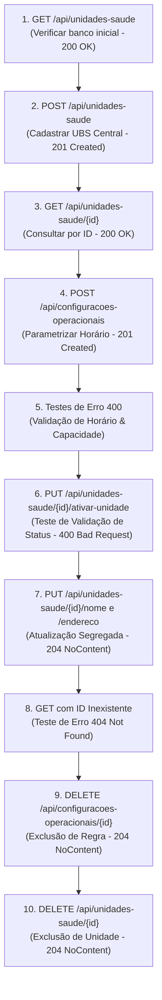

# 🧪 Nexa .NET — Guia de Validação & Roteiro de Testes da API
**Projeto:** Nexa (CitizenTech) — Global Solution 2026/2  
**Disciplina:** Advanced Business Development with .NET (FIAP)  
**Ambiente:** ASP.NET Core (.NET 10) + Oracle Database 19c  
**Interface de Testes:** Swagger UI (`http://localhost:5094/swagger` ou `https://localhost:7142/swagger`)  

---

## 🧭 1. Fluxo Sequencial de Testes Recomendado

Para demonstrar a solução de ponta a ponta (para banca, professor ou homologação interna), siga a sequência abaixo:



---

## 📋 2. Bateria de Testes com Payloads Prontos

---

### Teste 1: [GET] Listagem de Unidades de Saúde
* **Objetivo:** Verificar a conectividade com o Oracle e listar registros existentes.
* **Método:** `GET`
* **Rota:** `/api/unidades-saude`
* **Status Esperado:** `200 OK`
* **Resposta Esperada:** Array de unidades (ex: `[]` se vazio, ou lista com as UBS cadastradas).

---

### Teste 2: [POST] Cadastrar Nova Unidade de Saúde (Sucesso)
* **Objetivo:** Inserir a UBS com endereço estruturado (`[Owned]`) e status inicial ativo.
* **Método:** `POST`
* **Rota:** `/api/unidades-saude`
* **Request Body (JSON):**
```json
{
  "nomeUnidade": "UBS Vila Mariana - Dr. Cláudio Caroba",
  "codigoCnes": "2078015",
  "ativa": true,
  "endereco": {
    "logradouro": "Rua Domingos de Morais",
    "numero": "800",
    "complemento": "Bloco A - Térreo",
    "bairro": "Vila Mariana",
    "cidade": "São Paulo",
    "estado": "SP",
    "cep": "04010000"
  }
}
```
* **Status Esperado:** `201 Created`
* **Header de Resposta:** `Location: /api/unidades-saude/1`
* **Response Body Esperado:** Objeto completo da unidade com o `id` gerado pelo Oracle:
```json
{
  "id": 1,
  "nomeUnidade": "UBS Vila Mariana - Dr. Cláudio Caroba",
  "codigoCnes": "2078015",
  "ativa": true,
  "endereco": {
    "logradouro": "Rua Domingos de Morais",
    "numero": "800",
    "complemento": "Bloco A - Térreo",
    "bairro": "Vila Mariana",
    "cidade": "São Paulo",
    "estado": "SP",
    "cep": "04010000"
  },
  "configuracoes": []
}
```

---

### Teste 3: [GET] Buscar Unidade por ID (Sucesso)
* **Objetivo:** Recuperar os dados completos da unidade cadastrada.
* **Método:** `GET`
* **Rota:** `/api/unidades-saude/1`
* **Status Esperado:** `200 OK`
* **Response Body Esperado:** Objeto JSON correspondente ao ID informado.

---

### Teste 4: [POST] Cadastrar Configuração Operacional (Sucesso)
* **Objetivo:** Parametrizar a agenda semanal de funcionamento, capacidade e tempo médio de consulta vinculada à unidade 1.
* **Método:** `POST`
* **Rota:** `/api/configuracoes-operacionais`
* **Request Body (JSON):**
```json
{
  "unidadeSaudeId": 1,
  "diaSemana": 1,
  "horaAbertura": "07:00",
  "horaFechamento": "19:00",
  "capacidadeDiaria": 120,
  "tempoMedioAtendimentoMinutos": 15,
  "configuracaoAtiva": true
}
```
*(Nota: `diaSemana: 1` corresponde a `Segunda` no enum `DiaDaSemana`).*
* **Status Esperado:** `201 Created`
* **Header de Resposta:** `Location: /api/configuracoes-operacionais/1`

---

### Teste 5: [GET] Listar Configurações por Unidade
* **Objetivo:** Consultar as regras de funcionamento cadastradas para a unidade de ID 1.
* **Método:** `GET`
* **Rota:** `/api/configuracoes-operacionais/1`
* **Status Esperado:** `200 OK`
* **Response Body Esperado:** Array contendo as configurações daquela unidade.

---

### Teste 6: ❌ [POST] Teste de Validação de Regra de Negócio (Erro 400)
* **Objetivo:** Demonstrar o `NotificationPattern` quando a hora de abertura for posterior à hora de fechamento.
* **Método:** `POST`
* **Rota:** `/api/configuracoes-operacionais`
* **Request Body (JSON):**
```json
{
  "unidadeSaudeId": 1,
  "diaSemana": 2,
  "horaAbertura": "20:00",
  "horaFechamento": "07:00",
  "capacidadeDiaria": 100,
  "tempoMedioAtendimentoMinutos": 15,
  "configuracaoAtiva": true
}
```
* **Status Esperado:** `400 Bad Request`
* **Response Body Esperado:**
```json
{
  "status": 400,
  "erros": [
    "Hora da abertura deve ser anterior a hora de fechamento."
  ]
}
```

---

### Teste 7: ❌ [POST] Teste de Capacidade Inválida (Erro 400)
* **Objetivo:** Demonstrar rejeição quando a capacidade for menor ou igual a zero.
* **Método:** `POST`
* **Rota:** `/api/configuracoes-operacionais`
* **Request Body (JSON):**
```json
{
  "unidadeSaudeId": 1,
  "diaSemana": 3,
  "horaAbertura": "08:00",
  "horaFechamento": "17:00",
  "capacidadeDiaria": 0,
  "tempoMedioAtendimentoMinutos": 15,
  "configuracaoAtiva": true
}
```
* **Status Esperado:** `400 Bad Request`
* **Response Body Esperado:**
```json
{
  "status": 400,
  "erros": [
    "Capacidade diária da unidade deve ser maior que 0."
  ]
}
```

---

### Teste 8: ❌ [PUT] Ativar Unidade Já Ativa (Erro 400 de Domínio)
* **Objetivo:** Garantir que o sistema impeça ações redundantes sobre o estado da unidade.
* **Método:** `PUT`
* **Rota:** `/api/unidades-saude/1/ativar-unidade`
* **Status Esperado:** `400 Bad Request`
* **Response Body Esperado:**
```json
{
  "status": 400,
  "erros": [
    "Unidade de saúde já está ativa!"
  ]
}
```

---

### Teste 9: [PUT] Desativar Unidade de Saúde (Sucesso)
* **Objetivo:** Realizar a inativação semântica da unidade (soft disable para manutenção).
* **Método:** `PUT`
* **Rota:** `/api/unidades-saude/1/desativar-unidade`
* **Status Esperado:** `204 NoContent`
* *(Ao consultar `GET /api/unidades-saude/1`, o campo `"ativa"` constará como `false`).*

---

### Teste 10: [PUT] Atualizar Nome da Unidade (Segregação de Endpoints)
* **Objetivo:** Atualizar cirurgicamente apenas o nome da unidade sem tocar no endereço.
* **Método:** `PUT`
* **Rota:** `/api/unidades-saude/1/nome?nome=UBS Vila Mariana - Complexo Médico Central`
* **Status Esperado:** `204 NoContent`

---

### Teste 11: [PUT] Atualizar Endereço da Unidade
* **Objetivo:** Atualizar os dados do Value Object de endereço.
* **Método:** `PUT`
* **Rota:** `/api/unidades-saude/1/endereco`
* **Request Body (JSON):**
```json
{
  "logradouro": "Rua Domingos de Morais",
  "numero": "850",
  "complemento": "Edifício Anexo",
  "bairro": "Vila Mariana",
  "cidade": "São Paulo",
  "estado": "SP",
  "cep": "04010100"
}
```
* **Status Esperado:** `204 NoContent`

---

### Teste 12: [PUT] Atualizar Configuração Operacional
* **Objetivo:** Alterar horários e teto diário de atendimentos de uma regra existente.
* **Método:** `PUT`
* **Rota:** `/api/configuracoes-operacionais/1`
* **Request Body (JSON):**
```json
{
  "diaSemana": 1,
  "horaAbertura": "06:30",
  "horaFechamento": "20:00",
  "capacidadeDiaria": 150,
  "tempoMedioAtendimentoMinutos": 20,
  "configuracaoAtiva": true
}
```
* **Status Esperado:** `204 NoContent`

---

### Teste 13: ❌ [GET] Buscar Recurso Inexistente (Erro 404)
* **Objetivo:** Comprovar a resposta padronizada com mensagem JSON informativa para IDs inexistentes.
* **Método:** `GET`
* **Rota:** `/api/unidades-saude/99999`
* **Status Esperado:** `404 Not Found`
* **Response Body Esperado:**
```json
{
  "status": 404,
  "mensagem": "Não foi possível retornar unidade de saúde com ID: 99999"
}
```

---

### Teste 14: [DELETE] Excluir Configuração Operacional
* **Objetivo:** Remover uma regra de configuração operacional.
* **Método:** `DELETE`
* **Rota:** `/api/configuracoes-operacionais/1`
* **Status Esperado:** `204 NoContent`

---

### Teste 15: [DELETE] Excluir Unidade de Saúde
* **Objetivo:** Excluir fisicamente a unidade de saúde da base.
* **Método:** `DELETE`
* **Rota:** `/api/unidades-saude/1`
* **Status Esperado:** `204 NoContent`

---

## 🗄️ 3. Como Localizar e Auditar os Dados no Oracle SQL Developer

Se você abrir o **Oracle SQL Developer** ou **DBeaver** e não estiver visualizando as tabelas na árvore lateral, utilize as queries abaixo na planilha SQL para auditar os registros:

### 1. Localizar em qual Schema (Usuário) as tabelas foram criadas:
```sql
SELECT owner, table_name, num_rows, last_analyzed 
FROM all_tables 
WHERE LOWER(table_name) IN ('tb_unidades_gestao', 'tb_configuracao_operacional', '__efmigrationshistory');
```

### 2. Consultar as Unidades de Saúde (Com aspas obrigatórias):
```sql
SELECT "id", "nome_unidade", "codigo_cnes_unidade", "ativa", "cidade", "estado", "logradouro"
FROM "tb_unidades_gestao";
```

### 3. Consultar as Configurações Operacionais:
```sql
SELECT "id", "unidade_saude_id", "dia_semana", "hora_abertura", "hora_fechamento", "capacidade_diaria", "configuracao_ativa"
FROM "tb_configuracao_operacional";
```

### 4. Consultar o Histórico de Migrações do EF Core:
```sql
SELECT "MigrationId", "ProductVersion" 
FROM "__EFMigrationsHistory";
```

> **Por que as aspas duplas são obrigatórias no SQL Developer?**  
> Porque o Entity Framework Core mapeou as tabelas e colunas com nomes em minúsculo (`"tb_unidades_gestao"`). Sem as aspas, o compilador do Oracle converte a busca para maiúsculas (`TB_UNIDADES_GESTAO`) e informa falsamente que a tabela não existe (`ORA-00942`).

---

## 🔒 4. Durabilidade e Persistência Pós-Transações (ACID)

* **Os dados ficam salvos para a próxima execução?**  
  **SIM, 100% PERSISTIDOS.**  
  Diferente de um provedor em memória (`UseInMemoryDatabase`), o driver `Oracle.EntityFrameworkCore` grava as alterações diretamente nos datafiles e tablespaces físicos do Oracle Database em disco.  
* Cada chamada a `await _nexaDbContext.SalvarAlteracoes()` emite internamente um `COMMIT` na transação do banco.  
* Mesmo que você pare a API (`Ctrl + C`), feche o terminal ou reinicie a máquina, ao subir novamente a aplicação com `dotnet run`, **todos os registros cadastrados permanecerão exatamente onde foram salvos**.
