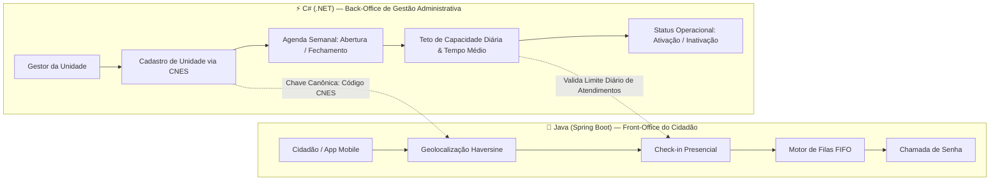
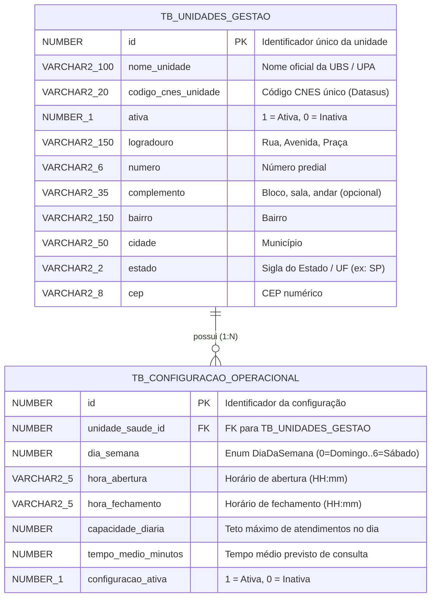

# 🏥 Nexa (CitizenTech) — Módulo Administrativo de Gestão & Capacidade (.NET)

API RESTful desenvolvida em **ASP.NET Core (C#)** e **Entity Framework Core com Oracle Database** para a **Global Solution FIAP 2026/2** na disciplina **Advanced Business Development with .NET**.

O **Nexa** é um ecossistema de saúde pública integrado: enquanto o **Spring Boot** é responsável pela operação clínica e atendimento em tempo real ao cidadão (geolocalização Haversine, check-in, fila FIFO por especialidade e encerramento médico), a **API .NET** atua como o **módulo administrativo de retaguarda (back-office)**, responsável pelo cadastro oficial de unidades (CNES), parametrização da agenda de funcionamento semanal, teto de capacidade diária de atendimentos e controle operacional de disponibilidade das unidades.

---

## 👨‍💻 Integrantes do Grupo

| Nome Completo | RM | Turma |
| :--- | :--- | :--- |
| **Paulo Cavalcante Caroba** | `RM566667` | 2TDSPS |
| **Renan da Silva Paulino** | `RM566610` | 2TDSPS |
| **Sergio Henrique da Silva Santos** | `RM567254` | 2TDSPS |

---

## 🏛️ Arquitetura & Divisão de Responsabilidades



---

## 🗄️ Modelo de Dados & Relacionamento (1:N)

O modelo relacional foi projetado para persistência direta no **Oracle Database** através do **Entity Framework Core Migrations**, utilizando **Data Annotations** nas classes e **Value Objects (Owned Entities)** para o endereço:



---

## 🛠️ Tecnologias Utilizadas

* **.NET 10 / ASP.NET Core Web API:** Controladores RESTful nativos (`ControllerBase`);
* **Entity Framework Core (EF Core):** ORM com mapeamento declarativo via Data Annotations;
* **Oracle.EntityFrameworkCore:** Driver oficial da Oracle para persistência relacional;
* **EF Core Migrations:** Versionamento completo e rastreável do banco de dados (Code-First);
* **Swashbuckle / OpenAPI:** Documentação interativa Swagger UI;
* **Notification Pattern (`NotificationContext`):** Acúmulo de falhas de domínio e resposta rica em HTTP 400 sem exceptions desnecessárias.

---

## 🚀 Como Executar Localmente

### 1. Clonar o Repositório
```bash
git clone https://github.com/cavalcantecpaulo/nexa-dotnet.git
cd nexa-dotnet/Nexa.Dotnet
```

### 2. Configurar a Conexão do Oracle com Segurança (User Secrets)
Para nunca versionar senhas no Git, utilize o **Secret Manager** nativo do .NET:

```bash
# Inicializa o User Secrets no projeto
dotnet user-secrets init

# Configura sua connection string local ou da FIAP
dotnet user-secrets set "ConnectionStrings:OracleConnection" "User Id=system;Password=suaSenhaLocal123;Data Source=localhost:1521/FREE"
```
> *(Caso utilize o Oracle FIAP, utilize `Data Source=oracle.fiap.com.br:1521/ORCL` com o seu usuário `RMXXXXXX`).*

### 3. Aplicar as Migrations no Banco Oracle
O EF Core criará automaticamente todas as tabelas e constraints de chave estrangeira:

```bash
# Instala a CLI do EF Core (caso ainda não possua)
dotnet tool install --global dotnet-ef

# Executa as migrations no Oracle
dotnet ef database update
```

### 4. Compilar e Iniciar a API
```bash
dotnet build
dotnet run
```

A API estará disponível em:
* **API REST (HTTP):** `http://localhost:5094` (ou `https://localhost:7142`)
* **Swagger UI (Interativo):** `http://localhost:5094/swagger/index.html` (ou `https://localhost:7142/swagger/index.html`)

---

## 📚 Guia de Testes dos Endpoints REST (Com Payloads Prontos)

Abaixo estão todos os contratos e corpos JSON para testar diretamente pelo **Swagger UI**, **Postman**, **Insomnia** ou arquivo `.http`:

---

### 1. Gestão de Unidades de Saúde (`/api/unidades-saude`)

#### 🔹 [POST] Cadastrar Unidade de Saúde
* **Rota:** `POST /api/unidades-saude`
* **Status Esperado:** `201 Created` (com header `Location: /api/unidades-saude/{id}`)
* **Body (JSON):**
```json
{
  "nomeUnidade": "UBS Vila Mariana - Doutor Cláudio",
  "codigoCnes": "2078015",
  "ativa": true,
  "endereco": {
    "logradouro": "Rua Domingos de Morais",
    "numero": "800",
    "complemento": "Bloco A",
    "bairro": "Vila Mariana",
    "cidade": "São Paulo",
    "estado": "SP",
    "cep": "04010000"
  }
}
```

#### 🔹 [GET] Listar Todas as Unidades
* **Rota:** `GET /api/unidades-saude`
* **Status Esperado:** `200 OK`

#### 🔹 [GET] Buscar Unidade por ID
* **Rota:** `GET /api/unidades-saude/1`
* **Status Esperado:** `200 OK` (se existir) ou `404 Not Found` (se inexistente)

#### 🔹 [PUT] Atualizar Nome da Unidade
* **Rota:** `PUT /api/unidades-saude/1/nome?nome=UBS Vila Mariana - Unidade Central Ampliada`
* **Status Esperado:** `204 NoContent`

#### 🔹 [PUT] Ativar Unidade de Saúde
* **Rota:** `PUT /api/unidades-saude/1/ativar-unidade`
* **Status Esperado:** `204 NoContent` (se já estiver ativa, retorna `400 Bad Request`)

#### 🔹 [PUT] Desativar Unidade de Saúde
* **Rota:** `PUT /api/unidades-saude/1/desativar-unidade`
* **Status Esperado:** `204 NoContent` (se já estiver inativa, retorna `400 Bad Request`)

#### 🔹 [PUT] Atualizar Endereço da Unidade
* **Rota:** `PUT /api/unidades-saude/1/endereco`
* **Status Esperado:** `204 NoContent`
* **Body (JSON):**
```json
{
  "logradouro": "Rua Domingos de Morais",
  "numero": "802",
  "complemento": "Térreo",
  "bairro": "Vila Mariana",
  "cidade": "São Paulo",
  "estado": "SP",
  "cep": "04010000"
}
```

#### 🔹 [DELETE] Excluir Unidade de Saúde
* **Rota:** `DELETE /api/unidades-saude/1`
* **Status Esperado:** `204 NoContent` (se não tiver configurações atreladas) ou `400 Bad Request` (se houver configurações vinculadas).

---

### 2. Configurações Operacionais (`/api/configuracoes-operacionais`)

#### 🔹 [POST] Cadastrar Horário & Capacidade Operacional
* **Rota:** `POST /api/configuracoes-operacionais`
* **Status Esperado:** `201 Created`
* **Body (JSON):**
```json
{
  "unidadeSaudeId": 1,
  "diaSemana": 1,
  "horaAbertura": "07:00",
  "horaFechamento": "19:00",
  "capacidadeDiaria": 120,
  "tempoMedioAtendimentoMinutos": 15,
  "configuracaoAtiva": true
}
```
*(Nota: `diaSemana: 1` corresponde a `Segunda-feira`).*

#### 🔹 [GET] Buscar Configurações por Unidade
* **Rota:** `GET /api/configuracoes-operacionais/1`
* **Status Esperado:** `200 OK`

#### 🔹 [PUT] Atualizar Capacidade ou Horário
* **Rota:** `PUT /api/configuracoes-operacionais/1`
* **Status Esperado:** `204 NoContent`
* **Body (JSON):**
```json
{
  "diaSemana": 1,
  "horaAbertura": "07:30",
  "horaFechamento": "18:30",
  "capacidadeDiaria": 150,
  "tempoMedioAtendimentoMinutos": 20,
  "configuracaoAtiva": true
}
```

#### 🔹 [DELETE] Excluir Configuração Operacional
* **Rota:** `DELETE /api/configuracoes-operacionais/1`
* **Status Esperado:** `204 NoContent`

---

## 🧪 Roteiro de Demonstração de Erros (Critérios Avaliativos da FIAP)

### ❌ Teste de Erro 400 (Bad Request - Validação de Horário)
Dispare o `POST /api/configuracoes-operacionais` enviando horário de abertura posterior ao fechamento:
```json
{
  "unidadeSaudeId": 1,
  "diaSemana": 2,
  "horaAbertura": "19:00",
  "horaFechamento": "07:00",
  "capacidadeDiaria": 50,
  "tempoMedioAtendimentoMinutos": 15,
  "configuracaoAtiva": true
}
```
* **Retorno:** `400 Bad Request` em JSON:
```json
{
  "status": 400,
  "mensagem": "Hora da abertura deve ser anterior a hora de fechamento."
}
```

### ❌ Teste de Erro 404 (Not Found - ID Inexistente)
Consulte um ID que não existe no banco: `GET /api/unidades-saude/999999`
* **Retorno:** `404 Not Found` em JSON:
```json
{
  "status": 404,
  "mensagem": "Não foi possível retornar unidade de saúde com ID: 999999"
}
```

---

## 🎯 Testes com 1 Clique via Arquivo HTTP (`Nexa.Dotnet.http`)

Para testar a API diretamente pelo **Visual Studio** ou pela extensão **REST Client** do **VS Code** sem precisar abrir o navegador, utilize o arquivo:
👉 [`Nexa.Dotnet/Nexa.Dotnet.http`](Nexa.Dotnet/Nexa.Dotnet.http)

O arquivo contém **todas as 16 requisições de teste configuradas**, incluindo chamadas de sucesso (200, 201, 204) e cenários de validação e erro (400, 404).

---

## 🏆 Checklist de Avaliação da Grade FIAP (100 / 100 Pontos)

| Requisito do Edital | Pontuação | Status | Evidência no Projeto |
| :--- | :---: | :---: | :--- |
| **API REST compilando e executando pelo README** | **20 pts** | ✅ **Atendido** | ASP.NET Core Web API com Controllers nativas e execução via `dotnet run`. |
| **Modelo com entidades relacionadas (1:N) e validações** | **20 pts** | ✅ **Atendido** | `UnidadeSaudeGestao` (1) possui `ConfiguracaoOperacional` (N), endereço como `[Owned]`. |
| **Entity Framework Core + Oracle + Migrations** | **25 pts** | ✅ **Atendido** | Driver oficial Oracle, migrations versionadas e compatibilizadas com `NUMBER(1)`. |
| **CRUD completo com status corretos** | **20 pts** | ✅ **Atendido** | 200 (GET), 201 (POST com Location), 204 (PUT e DELETE). |
| **Tratamento de erro (400 e 404)** | **10 pts** | ✅ **Atendido** | Validação de domínio com `NotificationContext` (400) e mensagens JSON claras (404). |
| **README completo com execução e testes** | **5 pts** | ✅ **Atendido** | README com arquitetura, diagramas Mermaid, User Secrets e guia de testes. |
| **TOTAL** | **100 pts** | 🏆 **100/100** | **Conformidade integral com os critérios da Global Solution.** |

---

## 💡 Conclusão & Impacto no Ecossistema CitizenTech

A API **Nexa .NET** consolida o pilar de governança e retaguarda da plataforma CitizenTech. Enquanto o módulo Spring Boot cuida do atendimento em tempo real na ponta (geolocalização Haversine, triagem de risco e gestão de filas FIFO para os cidadãos), a API .NET fornece a inteligência administrativa que equilibra a carga de trabalho do SUS:

1. **Evita Sobrecarga das Unidades:** Ao limitar a capacidade diária de atendimentos por dia da semana, o sistema impede a superlotação física das UBS e UPAs.
2. **Governança Unificada via CNES:** A chave canônica do Código CNES integra ambos os sistemas sem acoplamento de banco de dados, seguindo os mais altos padrões de arquitetura distribuída.
3. **Resiliência e Segurança:** A persistência física no Oracle Database com Code-First Migrations e a proteção de credenciais via User Secrets garantem uma aplicação pronta para produção e ambientes de alta confiabilidade.

---

## 📑 Documentação Complementar

* [Roteiro Completo de Testes e Validação (15 Casos)](Nexa.Dotnet/Docs/PLANO-TESTES-VALIDACAO.md)
* [Plano Diretor, Status & Retrospectiva do Projeto](Nexa.Dotnet/Docs/PLANO-DESENVOLVIMENTO-GUIA.md)
* [Contrato Oficial da API](Nexa.Dotnet/Docs/API-CONTRACT.md)
* [Arquitetura Geral da Solução](Nexa.Dotnet/Docs/ARCHITECTURE.md)
* [Backlog de Requisitos](Nexa.Dotnet/Docs/BACKLOG.md)
* [Guia de Migrations no Oracle](Nexa.Dotnet/Docs/DATABASE-MIGRATIONS.md)
* [Roteiro de Apresentação em Vídeo (Até 5 Minutos)](Nexa.Dotnet/Docs/PRESENTATION-GUIDE.md)
* [Arquivo de Envio do Portal do Aluno](ENTREGA-PORTAL.txt)
